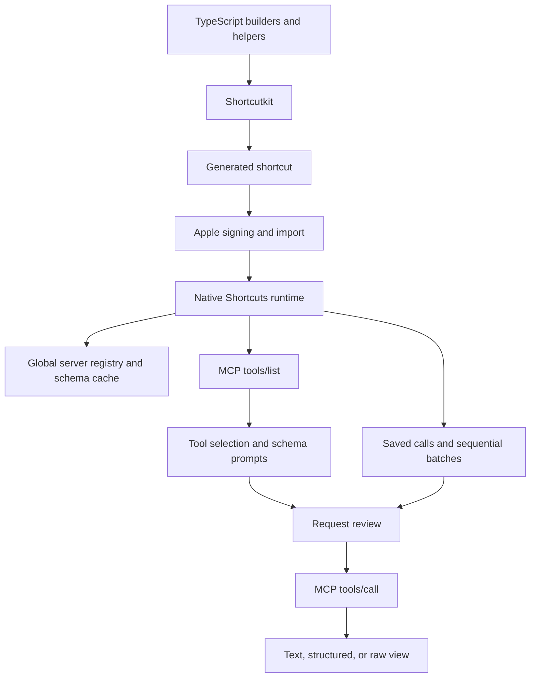

# From a property search to a reusable MCP client in macOS Shortcuts

A case study in generating native macOS automation with TypeScript and Shortcutkit.

**[Try MCP Toolkit on your Mac](https://www.icloud.com/shortcuts/a38cb4a66ec74df7bc272b809ad60c6f)**

MCP Toolkit was made for **macOS** and tested in the Mac Shortcuts app. iPhone and iPad compatibility has not been verified.

I created [Shortcutkit](https://github.com/frontboat/shortcutkit), the library used to generate this project. I built MCP Toolkit with a coding agent and tested the generated shortcuts in Apple's app. This case study documents that development process, including builder mistakes, native-runtime surprises, and the limits of what we verified.

Shortcutkit: [source](https://github.com/frontboat/shortcutkit) · [TypeScript package on npm](https://www.npmjs.com/package/shortcutkit) · [Python package on PyPI](https://pypi.org/project/shortcutkit/). This project uses the TypeScript package; the Python package was not used for the current client.

## The result

We built an Apple shortcut that accepts an MCP server URL, discovers its tools, prompts for arguments using the returned schemas, and executes requests without an AI model. It can remember servers, cache tool definitions, save named requests, and combine several saved calls into one report.

I verified those flows interactively in Apple's Shortcuts app. The shortcut is **MCP Toolkit**, available through the [shared iCloud link](https://www.icloud.com/shortcuts/a38cb4a66ec74df7bc272b809ad60c6f) or as a [local build](releases/README.md). The final signed release is allowlisted for Git; other generated shortcuts remain ignored. The build contains 416 native actions. Nine regression tests check generated structures and encodings; they do not replace native execution tests.

This is a working prototype for stateless HTTP MCP endpoints returning JSON. It is not a complete MCP client or a general workflow engine.

## The starting problem

The original task was narrow: find nearby commercial properties using current location and a radius. A cloud-built shortcut called the property service MCP endpoint and formatted sale and lease listings. After moving the files to a Mac, it imported successfully but failed during execution.

The first error appeared to be a failed property-service request. In fact, the displayed error value was blank. A later revision reached the results preview but produced rows with no property values. Type checks and a generated-workflow simulation had passed, so the failure was in assumptions about native Shortcuts behavior that those checks did not capture.

Rather than keep editing the full workflow, we built small diagnostic shortcuts and tested one behavior at a time.

## Establishing a trustworthy path

The diagnostics started with one fixed request and its raw response. That established that the endpoint and HTTP action worked independently of location, pagination, or optional-field logic.

Next came direct dictionary access, a three-record loop, and inspection of each complete record. One blank name turned out to be genuine source data: the third listing had an address but no `name` field. That observation separated missing data from broken extraction.

Formatting three records worked. Current location worked. A user-entered radius worked. Adding pagination then reproduced blank fields and incorrect item numbers. The inner loop was reading the outer loop's `Repeat Item` and `Repeat Index`. Explicit `Repeat Item 2` and `Repeat Index 2` references fixed the two-page test.

## The change in scope

Once the property-search path worked, the question became: could the same approach expose any server's MCP tools as forms?

The first generalization was a build-time generator. It read a saved `tools/list` response and used the schemas to generate a menu and input branches. That worked, including a multi-select list of optional fields, but its tool definitions were fixed when the shortcut was generated.

Adding an endpoint prompt did not make it a universal client. The destination changed while the tool menu remained tied to the original schema snapshot. The desired behavior was different: paste a URL, discover that server's tools now, select one, and fill in prompts derived from its live schema.

We therefore built a runtime schema interpreter as a fixed native action graph. Shortcutkit generates the interpreter; the imported shortcut fetches and interprets tool definitions during execution. The earlier static generator remains in [archive/static](archive/static) for comparison.

## Architecture

Bun and Shortcutkit run during building. At runtime, native Shortcuts actions handle HTTP, menus, dictionaries, storage, and previews. There is no intermediary application server and no language model choosing tools or constructing arguments.

The implementation is divided into a [builder](scripts/build.mts), [global server storage](src/mcp-global-storage.mts), [response views](src/mcp-response-viewer.mts), and [saved calls and batches](src/mcp-saved-calls.mts).

## Three storage decisions

We used Shortcuts' native global storage so independently imported versions and diagnostic shortcuts could share configuration.

**Servers:** a JSON object maps friendly names to endpoint URLs. This removes repeated URL entry.

**Schemas:** each endpoint has a separate copy of its complete `tools/list` response, keyed by endpoint and protocol version. Keeping the response whole preserves descriptions, annotations, input schemas, output schemas, and fields the current UI does not yet use. Cache reuse and refresh are explicit; automatic freshness handling remains future work.

**Calls:** a named entry stores an endpoint and the full request body. Replaying it reuses the saved arguments and still requires request review. It does not replay an old result.

A second-run test showed that storage had persisted correctly even though the server picker displayed “Text.” The bug was list construction, not storage. Replacing a List action containing mixed literal/reference items with a repeat-and-append variable pattern produced the expected saved-server names.

## What batch execution means here

The user can select several saved calls, review the actual execution order and request bodies, and run them sequentially. The shortcut combines their text under headings containing the saved-call name, server, and tool. A response without text falls back to its raw representation.

These calls are independent. The shortcut does not bind one result into another call's inputs. A tool-reported error is retained in the report and later calls continue; native network or permission failures may stop execution. There is no retry or partial-result recovery interface yet.

I verified the combined-output flow after the single-call save/replay path worked.

## Display is separate from transport

Different tools return different kinds of content. PublicSurplus returned a readable text table. The property service returned JSON inside a text block as well as structured data. Removing the outer JSON-RPC envelope made the first easier to read, but the second still needed formatting.

We built four small [display labs](examples/display): inspect tools and input definitions, extract text blocks, extract structured content, and render record fields using their actual keys. All four were tested in Shortcuts.

The main client now offers text, structured, and raw views. The field-label experiment is still separate. It demonstrated that generic record rendering is possible, but also exposed unfinished work: key ordering, readable labels, spacing, and nested objects. Cached `outputSchema` definitions could guide that work, but do not specify a presentation layout by themselves.

## What failed, and where responsibility sits

The table separates mistakes in this project's builders from native behavior and library API boundaries. We did not isolate a confirmed Shortcutkit implementation defect in these experiments. A valid generated representation and a passing typecheck did not, by themselves, prove native execution correctness.

| Observation | Attribution | Change in this project |
| --- | --- | --- |
| A generic Dictionary Value failed a text comparison | Native content-type behavior that the builder needed to account for | Coerce string-comparison subjects to `WFStringContentItem` |
| Inner record fields went blank after adding an outer page loop | Builder used references for the wrong repeat scope | Use the numbered inner-repeat references |
| New tool call opened the saved-call branch | Builder emitted menu branches in a different order from their labels | Align the orders and add a regression check |
| A URL displayed HTML in the review heading | Native URL-to-content conversion triggered by the chosen input type | Keep the endpoint input as Text |
| Stored names appeared as “Text” in a list | Unresolved interaction between our List encoding and the native engine; not isolated as a library defect | Use the verified repeat-and-append pattern |
| Blank content-item checks entered the wrong branch | Builder assumed item presence meant nonempty text | Test character count for that question |
| Numeric references became text dictionary items | Documented encoding default: references are Text unless the dictionary item type says otherwise | Explicitly set Number item types or send serialized JSON |

Shortcutkit supplied action identifiers, typed parameters, reference encoding, control-flow helpers, and file generation. Our code remained responsible for the runtime algorithm and the meaning of each reference. The local tests initially mirrored some incorrect assumptions, which explains why native tests found failures they missed.

The dynamic comparison helper also reaches into the generated action representation to set a variable-valued comparison. That is an API boundary worth improving or documenting upstream; it is not evidence that the current library serialized the value incorrectly. We have not made or claimed an upstream fix as part of this project.

The [Shortcutkit guide](docs/SHORTCUTKIT.md) records the patterns in more detail. These observations apply to the installed 3.1.0 package and the runtime used during development, rather than every release or possible action configuration.

## Protocol testing changed an assumption

An initialization request initially suggested the property service used only MCP `2025-11-25`. A later `server/discover` request explicitly reported support for `2026-07-28` too. We updated the client to send the newer version in its header and per-request metadata, along with method/name headers and client identity/capabilities. The property service and PublicSurplus requests then succeeded in native testing.

The client currently advertises that version directly. It does not perform version negotiation or implement the full specification. Server compatibility must be tested rather than inferred from a URL or one successful RPC.

## Show the working flow

The [demo script](docs/DEMO.md) lays out a short recording: paste a server URL, discover a tool, fill in inputs, inspect a result, then combine two saved calls. It is a recording plan, not a claim that a demo video has already been captured.

## Limits and next work

The prototype handles basic schema-driven inputs and direct local references; complex inputs generally require JSON entry. It has no OAuth interface, SSE parser, stdio transport, full schema validation, discovery/result pagination, subscriptions, or multi-round-trip request handling.

Storage has no built-in rename/delete UI, automatic TTL handling, or concurrency control. Saved calls are not checked against changed schemas before replay. Global arguments should not be treated as secret storage. Cross-device storage behavior has not been verified.

The next useful improvements are schema-aware structured display, richer input forms, cache freshness metadata, saved-call management, and explicit protocol negotiation. Dependency chaining would be a separate feature from the current independent-call batches.

The central engineering finding is practical: typed generation made a large native workflow maintainable, while small native experiments established which generated patterns actually worked. Both were necessary to turn the original failing shortcut into a reusable client.
