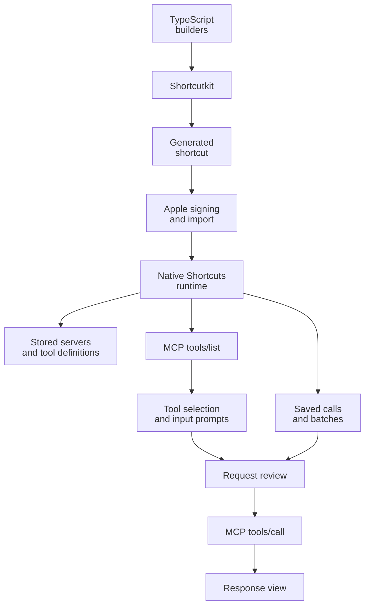

# From property search to an MCP client in macOS Shortcuts

I created [Shortcutkit](https://github.com/frontboat/shortcutkit), then used its TypeScript package with a coding agent to build MCP Toolkit. This case study records the builder mistakes and native-runtime behavior we found by testing in Apple's Shortcuts app.

[Try MCP Toolkit on your Mac](https://www.icloud.com/shortcuts/a38cb4a66ec74df7bc272b809ad60c6f), or [build it locally](releases/README.md). iPhone and iPad compatibility is unverified.

## The result

MCP Toolkit accepts a server URL, discovers tools, prompts for arguments, and sends requests without an AI model. It saves servers, tool definitions, and named calls, and combines independent calls into one report.

I verified those flows in Shortcuts. The build contains 416 native actions; nine regression tests check generated structures and encodings. Those tests do not execute Apple's runtime. The prototype supports stateless HTTP endpoints returning JSON, with the [limitations recorded in project status](docs/STATUS.md#known-limitations).

## The starting problem

The original task was to find nearby commercial properties using current location and a radius. A shortcut built in the cloud imported on a Mac but failed during execution.

The first apparent request error displayed a blank value. A later revision reached the preview but showed rows without property values. Type checks and a generated-workflow simulation had passed. We needed to test the assumptions those checks missed.

We began with one fixed request and its raw response, confirming that the endpoint and HTTP action worked. Then we inspected complete records in a three-record loop. The third listing had an address but no `name`: that blank was source data, not broken extraction.

Formatting, location, and a user-entered radius worked. Pagination brought back blank fields and incorrect item numbers. The inner loop read the outer loop's `Repeat Item` and `Repeat Index`. Using `Repeat Item 2` and `Repeat Index 2` fixed the two-page test.

## From fixed forms to runtime discovery

Our first generalization read a saved `tools/list` response during building and generated fixed tool menus and prompts. Adding an endpoint prompt changed the destination but left the tool definitions tied to that snapshot.

We wanted the shortcut to discover tools from the selected server. Shortcutkit now generates a fixed action graph that fetches and interprets schemas at runtime. The earlier generator remains in [archive/static](archive/static).

Bun and Shortcutkit run during building. Native Shortcuts actions handle requests, input, storage, and previews on the Mac; no intermediary application server is involved. The [implementation guide](docs/SHORTCUTKIT.md) covers the builder modules and encodings.

## Storage and batches

Native global storage lets imported versions and diagnostic shortcuts share configuration. Server entries map names to URLs. Each endpoint's cache holds its complete `tools/list` response, preserving fields the current UI does not use. Users choose cache reuse or refresh.

Saved calls retain the endpoint and request body. Replay reuses the arguments after review. Batches show the execution order and request bodies, then combine results under call, server, and tool headings. Responses without text fall back to their raw representation. I verified batch output after single-call replay worked.

Calls run independently: results do not become later inputs. Tool-reported errors remain in the report while later calls continue; native network or permission failures may stop execution. There is no retry or partial-result recovery interface.

A second-run test exposed a separate storage-picker issue. Values persisted, but the picker displayed “Text.” Replacing a List action containing mixed literal/reference items with a repeat-and-append pattern displayed the saved-server names.

## Display experiments

PublicSurplus returned a readable text table. The property service returned JSON inside a text block as well as structured data. Extracting text removed the envelope but did not format the embedded JSON.

We built four [display labs](examples/display): inspect tools, extract text, inspect structured content, and render labeled record fields. Tools and Text passed native testing. The current Structured and Field View fixtures still need native verification.

The main client offers text, structured, and raw views. Field View remains separate: nested objects appear as JSON, field order follows the data, and labels and spacing need work. Cached `outputSchema` definitions may help, but do not prescribe a layout.

## Failures and attribution

We did not isolate a confirmed Shortcutkit implementation defect. These observations concern our builders, native behavior, and the installed 3.1.0 API:

| Observation | Cause or boundary | Change |
| --- | --- | --- |
| Dictionary Value failed a text comparison | Native content-type behavior | Coerce to `WFStringContentItem` |
| Nested record fields went blank | Builder referenced the outer repeat | Use numbered inner-repeat references |
| New tool call opened the saved-call branch | Branch order differed from menu labels | Align orders; add a regression check |
| Review heading displayed HTML instead of a URL | URL input triggered native content conversion | Use Text input |
| Saved names displayed as “Text” | List encoding/native interaction; no library defect isolated | Use repeat-and-append |
| Blank-value checks took the wrong branch | Builder equated item presence with nonempty text | Count characters |
| Numeric references became text dictionary items | References default to Text item encoding | Set Number item types or send serialized JSON |

Shortcutkit supplied typed actions, references, control flow, and file generation. Our builders still had to select the right references and encodings. Some local tests mirrored our incorrect assumptions.

Dynamic comparisons also required writing a variable-valued parameter into the generated action representation. That API boundary may warrant upstream documentation or improvement; we neither established an incorrect library serialization nor made an upstream fix.

## Protocol testing

An initialization response suggested that the property service supported only MCP `2025-11-25`. A later `server/discover` response reported `2026-07-28` support too. After updating headers and per-request metadata, requests to the property service and PublicSurplus succeeded in native testing.

The client advertises that version without negotiation. One successful request does not establish full protocol compliance or compatibility with another server.

## Next work

Priorities are structured-data display, richer input forms, cache freshness, saved-item management, and protocol negotiation. Replay does not check for schema changes. Global arguments are accessible to other shortcuts; cross-device storage behavior is unverified. See [data handling](docs/PRIVACY.md).

The [demo script](docs/DEMO.md) plans a recording; no video is included. Small native experiments remain the method for checking behavior that typed generation and structural tests cannot establish.
